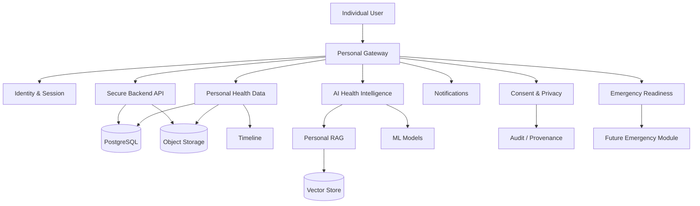
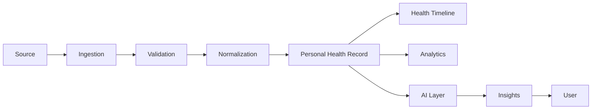

# Module 1 Architecture

## 1. Architectural Goal

Module 1 shall operate as an individual-centered platform. A user's health data can originate from manual entry, uploaded documents, devices, and future authorized healthcare organizations.

## 2. Runtime Architecture

- Frontend: React + TypeScript.
- API backend: FastAPI.
- Relational database: PostgreSQL.
- Spatial capabilities: PostGIS where care-navigation location queries require them.
- Cache/background work: Redis and a task worker where necessary.
- File storage: object storage abstraction with local development storage.
- AI layer: isolated inference services/modules.
- Development-first API mocking: MSW.
- Deployment: Docker-based.

## 3. Architectural Style

Start as a **modular monolith** with explicit domain boundaries. Do not introduce dozens of microservices at the first milestone.

Boundaries include:

- identity;
- profile;
- health records;
- documents;
- laboratory;
- vitals;
- medications;
- appointments;
- emergency;
- consent/privacy;
- notifications;
- AI.

This allows later extraction of high-load components without forcing early distributed-system complexity.

## 4. Core data flow

## 5. Security boundary

The frontend is never the final authorization authority. APIs must validate:

- identity;
- session;
- user ownership;
- resource authorization;
- requested operation;
- consent context where external sharing is involved.

## 6. Availability principle

Core profile and previously stored health information should remain readable when non-critical external services fail. External AI, maps, messaging, or OCR failures must not crash the Personal Gateway.
