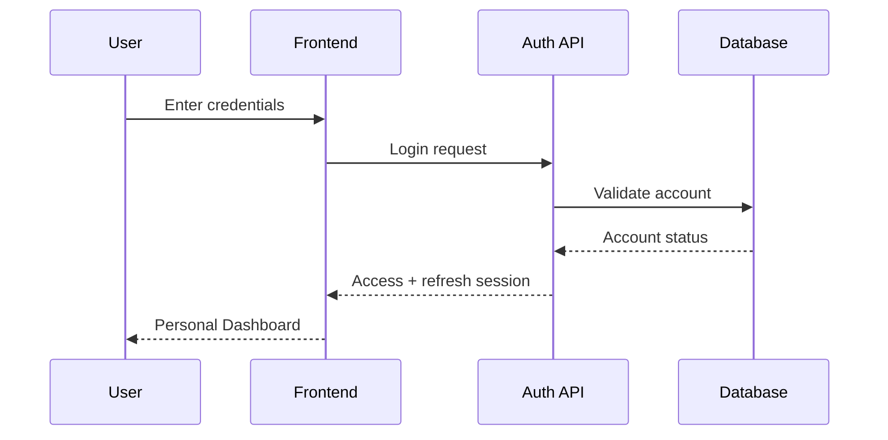

# Authentication

## 1. Objectives

Provide secure account access for personal users while supporting future integration with organizational identities.

## 2. Authentication flow



## 3. Requirements

- password hashing using a modern password hashing function;
- short-lived access tokens;
- refresh-token rotation where implemented;
- secure session invalidation;
- account lockout/rate-limit policy;
- optional MFA;
- email/phone verification according to deployment requirements;
- password reset;
- device/session management.

## 4. Demo mode

Development may use demo accounts and/or frontend fallback authentication only when explicitly enabled.

```text
FEATURE DEMO MODE = development only
PRODUCTION = disabled
```

Mock authentication must never become the production authentication mechanism.

## 5. Session security

- Never put secrets in frontend source.
- Never log credentials or tokens.
- Use secure transport in deployed environments.
- Revoke sessions on account security events.
