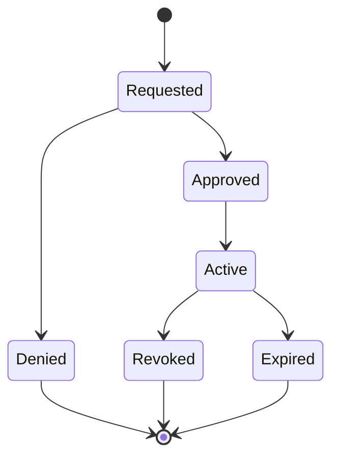

# Consent Management

## 1. Goal

Allow an individual to control whether external organizations or future ecosystem modules may access defined parts of personal health information.

## 2. Consent object

A consent grant should include:

- grantor;
- recipient;
- scope;
- purpose;
- start time;
- expiry time;
- status;
- created time;
- revocation time if revoked.

## 3. Consent lifecycle



## 4. Scope examples

```text
LAB_REPORTS
PRESCRIPTIONS
ALLERGIES
EMERGENCY_PROFILE
VITAL_TRENDS
FULL_RECORD  # only if explicitly supported by policy
```

## 5. Principle

Consent must be:

- explicit;
- understandable;
- scoped;
- revocable;
- auditable;
- time-bounded where appropriate.

## 6. Emergency exception

Any future emergency break-glass capability must be governed separately, with reason capture and detailed auditing. It must not silently bypass privacy controls.
