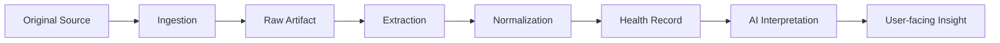

# Data Provenance

## 1. Goal

Every health item should be traceable to its source and transformation path.

## 2. Provenance chain

## 3. Required provenance metadata

For each imported artifact:

- source type;
- source name;
- source reference;
- original filename where applicable;
- checksum/hash where appropriate;
- created date if present;
- imported date;
- parser/OCR version;
- verification status;
- derived-record relationship.

## 4. AI provenance

AI-generated statements should preserve references to:

- source record IDs;
- source document IDs;
- time period;
- model/version;
- generation timestamp.

## 5. Why it matters

The user and future clinicians should be able to distinguish:

- original source data;
- calculated values;
- ML predictions;
- LLM-generated explanations.

No AI-generated interpretation should overwrite the original source record.
