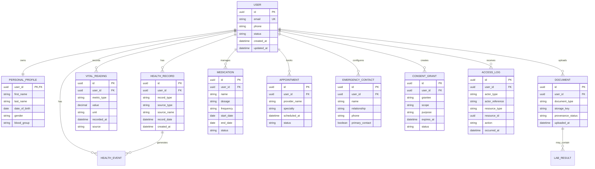

# Personal Gateway Database Design

## 1. Database

Primary database: PostgreSQL.

Use relational normalization for core entities and JSON only where flexible metadata is appropriate.

## 2. Core entities

## 3. Data provenance

Every health record/document should preserve:

- source;
- source organization where known;
- original record/document reference;
- recorded date;
- import date;
- verification status;
- transformation history;
- AI-derived status where applicable.

## 4. Data retention

Retention policy must be configurable by deployment and jurisdiction. Avoid deleting source medical documents as a side effect of deleting derived summaries.

## 5. Indexing

Index:

- user_id;
- record_date;
- metric_type + recorded_at;
- medication status;
- appointment date;
- consent status + expiry;
- access log timestamp.

## 6. Soft deletion

Prefer deactivation/soft deletion for core health records where required by policy. Permanent deletion must be an explicit policy-driven operation.
