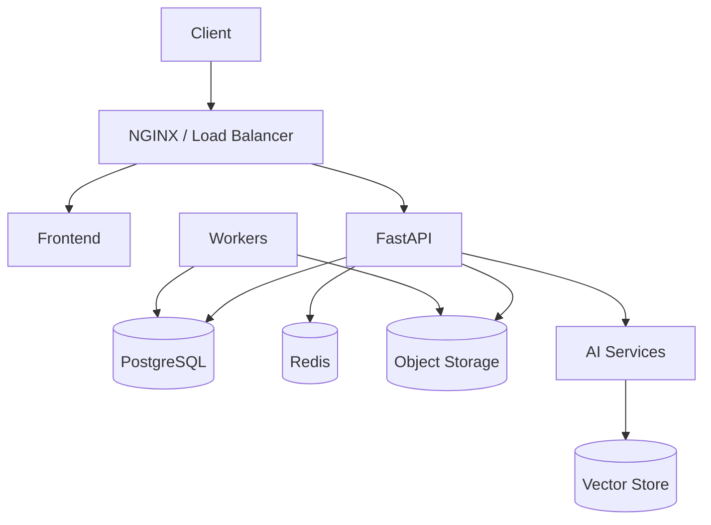

# Deployment

## 1. Environments

Maintain:

```text
development
staging
production
```

## 2. Development

Development can use:

- Docker Compose;
- local PostgreSQL;
- Redis;
- MSW;
- synthetic data;
- local object storage.

## 3. Staging

Staging should use:

- production-like build;
- real API path;
- isolated database;
- synthetic/anonymized test data;
- TLS;
- monitoring;
- CI/CD deployment.

## 4. Production

Production must disable:

- MSW;
- demo authentication;
- development secrets;
- debug mode.

Production requires:

- TLS/HTTPS;
- secret management;
- persistent database;
- durable document storage;
- backups;
- migration strategy;
- monitoring;
- alerting;
- audit logging;
- disaster recovery plan.

## 5. Container architecture



## 6. Deployment rule

Never deploy an untested database migration or unverified AI model directly to production.

Use staged rollout and rollback procedures.
