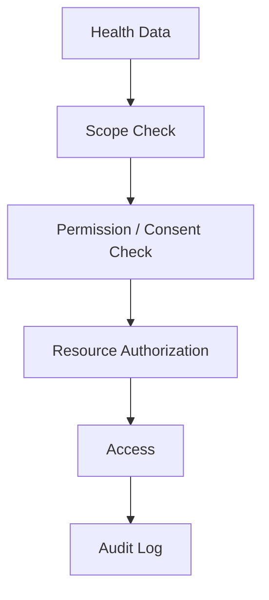

# Privacy

## 1. Principle

Health information is sensitive. Module 1 follows privacy-by-design and data-minimization principles.

## 2. Data minimization

Collect only information necessary for the requested feature.

Examples:

- Emergency responders should not need the user's billing records.
- Care-navigation does not need unrelated clinical notes.
- AI retrieval should only retrieve records within the user's authorized data scope.

## 3. Privacy architecture

## 4. User visibility

The Personal Gateway should allow the user to review:

- active sessions;
- connected sources;
- access history;
- consent grants;
- consent expiry;
- data-sharing scope.

## 5. AI privacy

AI prompts should be constructed from only the context required to answer the question.

Do not send unrelated personal records to an external AI provider.

Where external inference is used, provider configuration and data-processing terms must be evaluated before deployment.

## 6. Development data

Development/testing must use synthetic data. Real patient information must not be placed in the repository or test fixtures.
