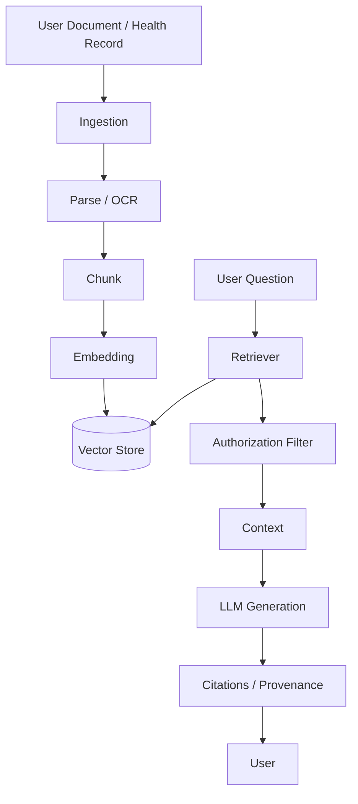

# Personal RAG Architecture

## 1. Objective

The Personal RAG system allows the AI assistant to answer questions using the user's authorized records and documents.

## 2. Pipeline

## 3. Authorization rule

Retrieval must be filtered by user identity and record scope **before generation**.

A document belonging to another user must never enter the model context.

## 4. Metadata

Vector chunks should include:

- user_id;
- document_id;
- record_id;
- source;
- timestamp;
- document type;
- access scope.

## 5. Retrieval

Use hybrid retrieval where beneficial:

- semantic similarity;
- keyword/metadata filtering;
- recency;
- record type;
- source authority.

## 6. Hallucination control

The assistant should:

- prefer retrieved context;
- cite sources;
- say "not found in your records" when appropriate;
- avoid inventing values;
- avoid claiming medical certainty from incomplete records.

## 7. Storage

Development may use Chroma or FAISS. Production vector persistence should use durable storage and access controls.

Vector stores must not be treated as the authoritative health record.
