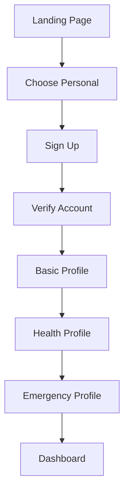
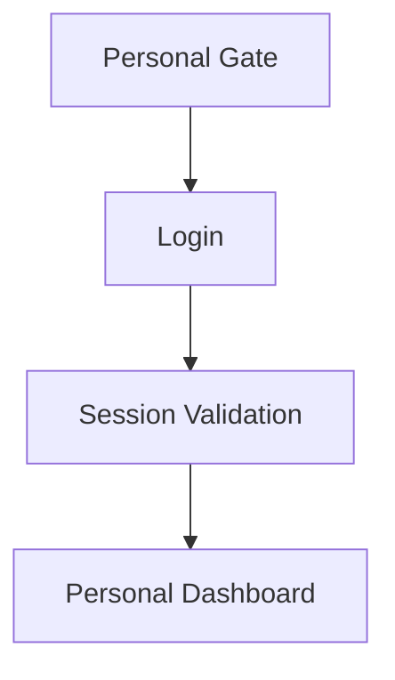
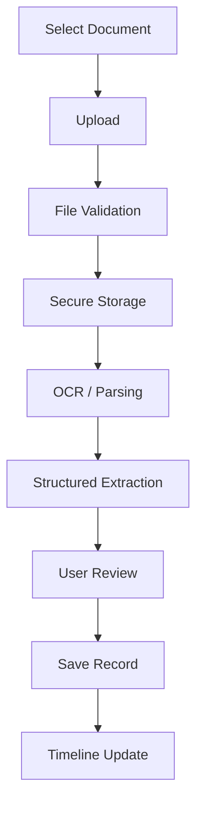
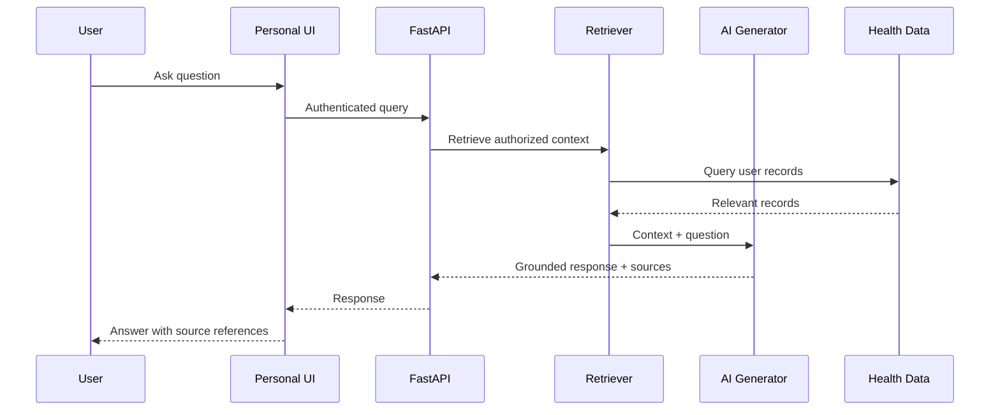
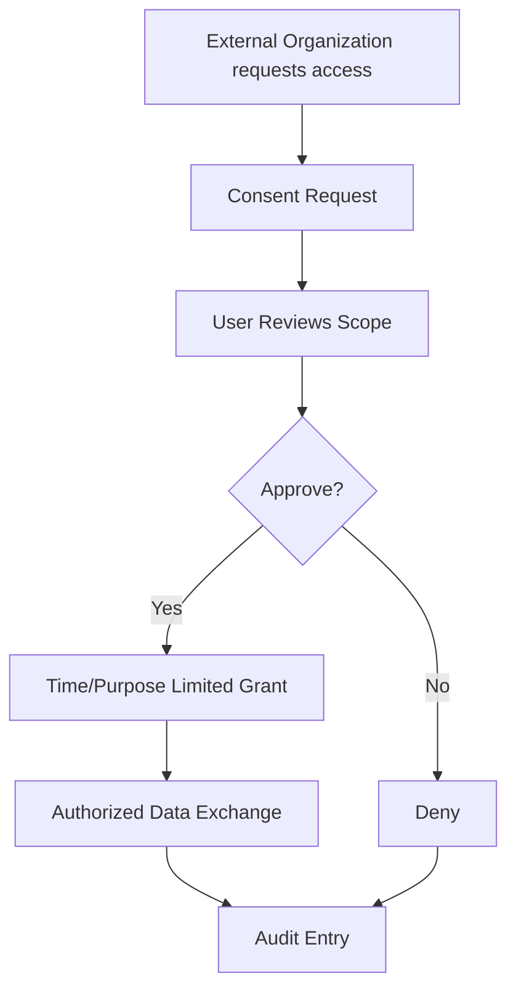

# Module 1 User Flows

## 1. First-time user



## 2. Returning user



## 3. Upload health document



## 4. AI question flow



## 5. Consent flow



## 6. Emergency readiness

The Personal Gateway prepares information for a later Emergency module:

```text
Emergency Profile
→ Blood Group
→ Severe Allergies
→ Critical Conditions
→ Emergency Contacts
→ Preferred Hospital
→ Sharing Preferences
```

No autonomous emergency dispatch is implemented by Module 1 itself.
